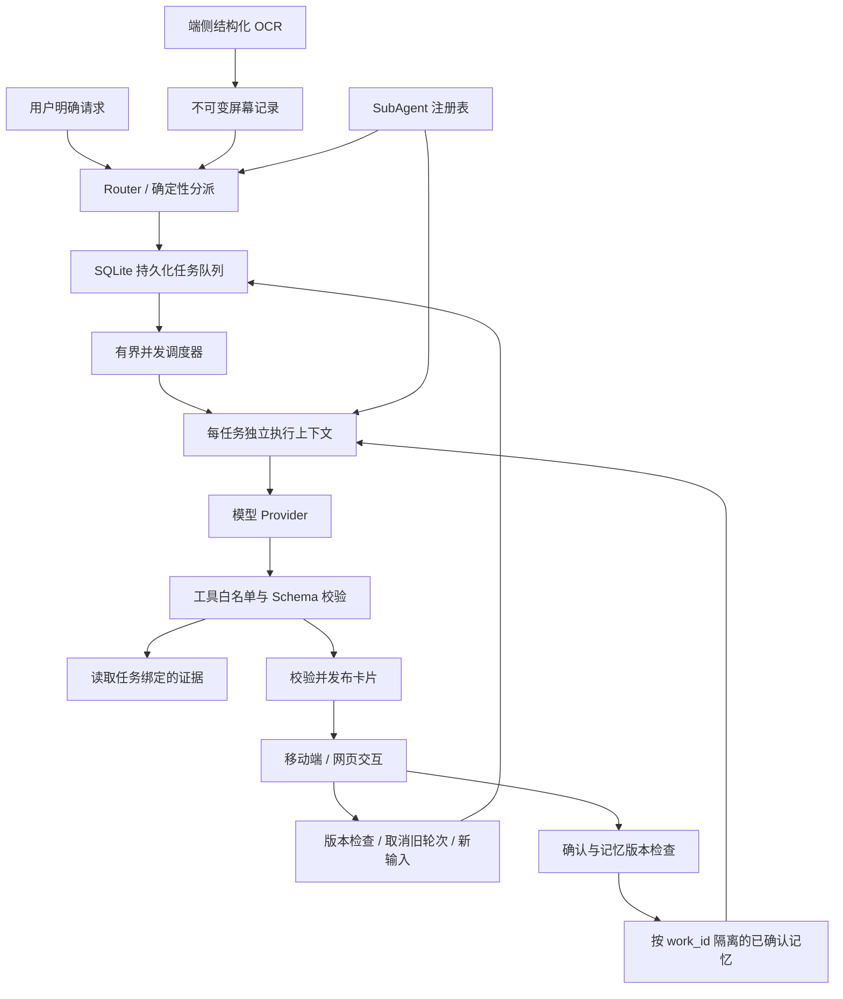
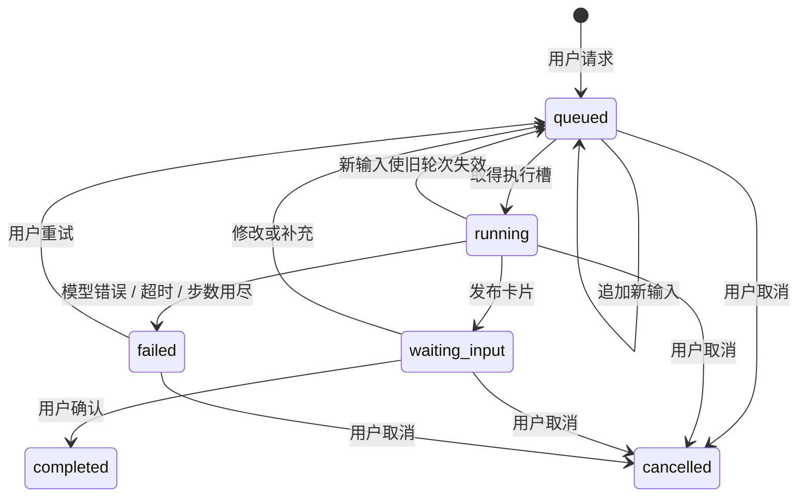

# 框架设计与取舍 v0.2

## 数据流

Router 是独立的确定性分派类，从 Registry 查找能力：事项绑定优先，显式 subagent_id 次之，否则匹配插件声明的关键词，未匹配时用 information。多能力冲突要求显式选择。已有任务固定在原能力；OCR 上传只存储。框架不包含 Party 人数、预算或职责规则。

## 状态与版本

- `revision` 是任务控制版本。每次用户操作及重启恢复递增，旧 Worker 只有在 revision 相同且任务仍 running 时才允许发布。
- `memory_version` 是事项已确认记忆版本；任务保存执行开始时的 memory_base，确认时比较，过期则返回 409。
- `card_version` 是结果版本，只在有效卡片发布时递增。用户动作同时检查任务版本与卡片版本。
- 幂等键按工作区、操作类型和 event_id 分域；动作额外按 task_id 分域。相同键不同内容返回冲突。
- 数据修改与对应事件在同一 SQLite 事务内提交。事务中不等待模型。
- 后台循环默认两个 Worker。每个模型调用在独立任务消息列表中运行，不共享对话历史。

## 恢复保证

恢复的保证是**任务不丢失，旧结果不覆盖新状态**，不是模型 API 的 exactly-once 计费。进程中断后，running 任务重新计算该轮。当前只有读取证据和提交本地卡片两个工具，因此重复推理不会重复发送消息或重复写日历。

将来增加外部写操作时，必须为每种工具增加操作幂等键、结果账本、权限和用户确认，并处理“服务商已执行但本地未收到响应”的不确定状态。不能直接把现有重跑策略套用到付款或发消息。

当前版本用单进程 SQLite 和内存执行槽。跨进程部署需要数据库租约、分布式队列和执行所有权，不能单纯开启多个 Uvicorn worker。OS 文件锁在启动时强制这个约束。

## 上下文与工具

所有传给模型的 OCR 是不可信材料，用户任务与材料在消息中明确标注。工具只允许读取当前任务的 screen_ids、所属 work_id 的执行快照以及当前任务用户补充；卡片引用必须属于这些已授权来源。提示词隔离不构成完整的语义安全保证，因此第一版没有 shell、任意 HTTP、文件访问或外部写入工具。

模型通过 `read_screens` 获得材料和事项记忆，通过插件声明的输出工具（`present_card` / `present_party`）提交结构化结果。无效工具参数会返回工具错误供模型修正；执行步数和总时间有硬上限。HTTP 429 与部分 5xx、网络错误最多重试两次，认证错误不重试。

Worker 只保留通用上下文读取和插件输出两个分支，业务 Schema 与处理函数由 Registry 提供。插件得到快照而不持有数据库操作能力。详见 [SubAgent 扩展契约](subagents.md)。

## 扩展路径

1. **接入真实模型**：保留 Provider 接口，使用工具调用契约测试和小型 OCR 样例集验证。
2. **接入 Android**：转换 T 文档 payload，复用 HTTP 与卡片协议。
3. **增加业务能力**：实现 SubAgent 协议并注册能力；无需修改任务生命周期。需要外部工具时另加异步工具权限与幂等接口。
4. **语义 Router**：先只输出 ignore/create/attach 建议，再接入真实任务变更；按真实事件测误触发与重复建任务。
5. **多 Agent**：任务 Worker 内部按需拆分子任务，上层仍保持统一 task_id 和版本。

## 与 DeepSeek 设计的关系

沿用思想：任务与会话分离、Router/Worker 职责划分、任务上下文隔离、明确输入的直接投递、状态持久化。当前不等同于完整原型，没有 Thread 多对多订阅、Chain of Recall、智能 Watchdog 或云端执行环境拆分。

参考：[领域模型](https://github.com/deepseek-ai/dsh-superagent-prototype/blob/main/docs/001-domain.md)、[执行机制](https://github.com/deepseek-ai/dsh-superagent-prototype/blob/main/docs/003-execution.md)、[核心端口](https://github.com/deepseek-ai/dsh-superagent-prototype/blob/main/src/core/ports.ts)。
